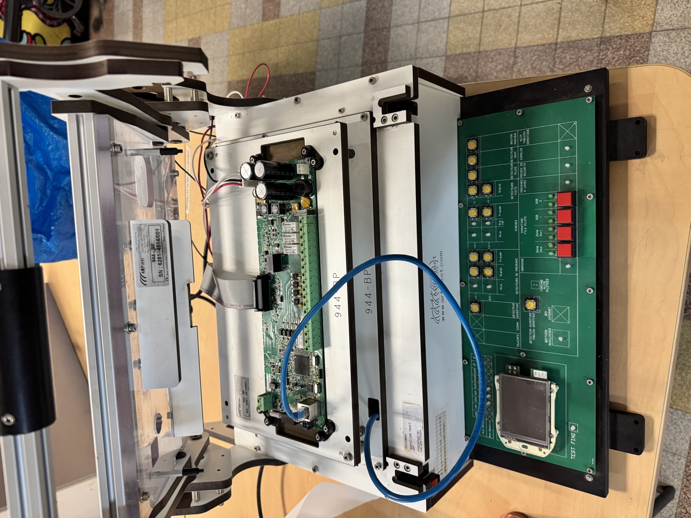

# essensys-test-banc-SC944D

Archives et documentation du **banc de test de production du boîtier principal (BP)** Essensys, carte **SC944**.

> **Dépôt privé.** Il contient des plans de la société ARF Test, des documents de fabricants et une spécification marquée confidentielle. Ne rien copier d'ici vers un dépôt public sans vérifier les droits. La synthèse publique est dans `essensys-doc`.



## En bref

| | |
|---|---|
| Rôle | Tester en fin de fabrication chaque carte BP : alimentations, pilotage et forçage du +15VSP, alimentations d'alarme, bus du boîtier auxiliaire (BA), puis entrées et sorties à la main |
| Mécanique | Interface à lit de clous ARF Test « ARF-PLC 320 », affaire **6281**, n° de série 6281-4514/001, étiquette d'inventaire 0010630 |
| Électronique | Carte d'interface **SI841A** (« carte banc de test BP »), microcontrôleur dsPIC33FJ256GP710A, 19 folios. Conception et logiciel : dépôt public [`essensys-board-SC841A`](https://github.com/essensys-hub/essensys-board-SC841A) |
| Carte testée | SC944 (points de test relevés sur la SI944C), 74 points de test + Ethernet |
| Période | Étude de juillet 2014 à février 2015 (Valentinéa) |
| Suivi | [essensys-hub/essensys-doc#36](https://github.com/essensys-hub/essensys-doc/issues/36), corrigé par [#38](https://github.com/essensys-hub/essensys-doc/issues/38) |

## Documentation

| Page | Contenu |
|---|---|
| [docs/01-presentation.md](docs/01-presentation.md) | À quoi sert le banc, ce qu'il contient, historique |
| [docs/02-architecture.md](docs/02-architecture.md) | Alimentations, sécurité 230 V, liaisons entre le banc et la carte testée |
| [docs/03-sequence-de-test.md](docs/03-sequence-de-test.md) | Séquence automatique du logiciel de test, étape par étape |
| [docs/04-carte-interface-si841a.md](docs/04-carte-interface-si841a.md) | Carte SI841A : folio par folio, signaux du microcontrôleur, face avant |
| [docs/05-points-de-test.md](docs/05-points-de-test.md) | Points de test de la SC944 |
| [docs/06-mecanique.md](docs/06-mecanique.md) | Dossier ARF Test 6281, nomenclature |
| [docs/07-mode-operatoire.md](docs/07-mode-operatoire.md) | Ce que fait l'opérateur, lecture des voyants |
| [docs/08-inventaire.md](docs/08-inventaire.md) | Inventaire des fichiers, manques, points à vérifier |
| [docs/correspondance.csv](docs/correspondance.csv) | Ancien chemin → nouveau chemin des 103 fichiers d'origine |

## Arborescence

```
carte-interface-SI841A/   carte électronique du banc
  schema/                 schéma Altium (PDF, v4 ; v1 en archives)
  gerber-non-route-envoye-arf-test/   contour, perçages et sérigraphie envoyés à ARF Test
  face-avant/             dessin de la face avant (CI v5 ; v1 à v4 en archives)
  serigraphie/            sérigraphies Illustrator
points-de-test-SC944/     position et nom des points de test sur la carte BP
logiciel/                 spécification du logiciel de test (v4 ; v0 à v3 en archives)
mecanique-arf-test-6281/  dossier d'étude mécanique ARF Test (plans, nomenclature)
etude/                    croquis, scans, calculs, liste de câbles
datasheets/               composants, routeur, compteur
photos/                   photos du banc (2016 et 2026)
docs/                     documentation rédigée
```

## Où trouver quoi

| Besoin | Où |
|---|---|
| Fichiers Altium, routage final, Gerber de fabrication, nomenclature de la SI841A | `essensys-board-SC841A` (public) |
| Code source et binaire du logiciel de test (`Banc_BP_V2_FAST`), notes de version | `essensys-board-SC841A/SC841A/Prog/` |
| Spécification du logiciel, plans des points de test, mécanique, croquis, photos | ici |

Banc cousin pour les boîtiers auxiliaires : dépôt privé `essensys-test-banc-BoitierSecondaire`.

Ce qui manque encore : une notice d'utilisation et le plan de câblage du lit de clous. Voir [docs/08-inventaire.md](docs/08-inventaire.md).
