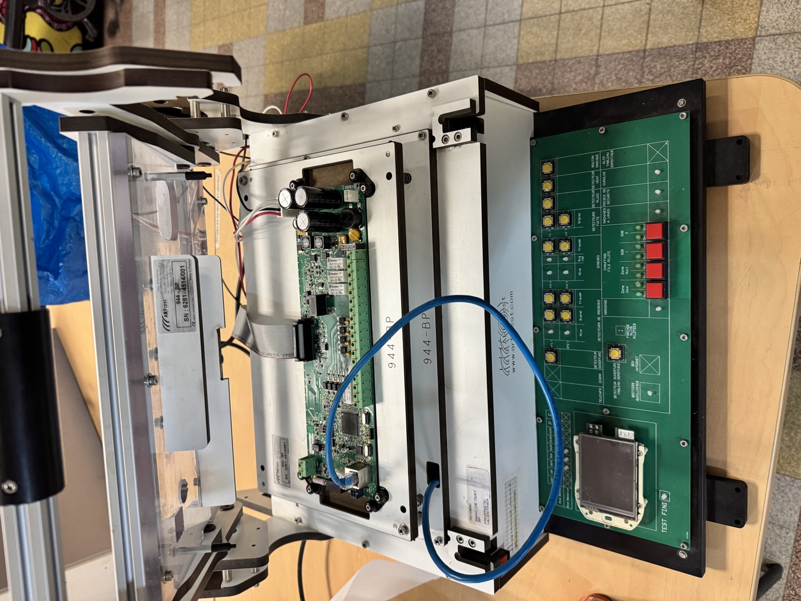

# 1. Présentation

## Rôle

Le banc sert à contrôler une carte **boîtier principal (BP) SC944** à la sortie de fabrication. L'opérateur pose la carte sur le lit de clous, ferme la presse, et le banc :

1. alimente la carte comme le ferait une installation réelle (24 V « secteur », puis 12 V « secouru ») ;
2. mesure les tensions internes de la carte et allume un voyant vert ou rouge par tension ;
3. vérifie que la carte sait couper et rétablir le +15VSP (pilotage et forçage) ;
4. vérifie les alimentations d'alarme et celle du bus des boîtiers auxiliaires (BA) ;
5. répond aux trames du bus BA pour que la carte valide elle-même la communication ;
6. offre des boutons, des voyants et des borniers pour tester à la main les entrées et sorties de la carte (alarme, détecteurs, arrosage, fil pilote, machines à laver, prises de sécurité, cumulus).

Dans la spécification, la carte testée est appelée **UUT** (*unit under test*) et le banc **BDT**.

## Ce que contient le banc

| Élément | Description | Source |
|---|---|---|
| Interface mécanique | Coffret ARF Test « ARF-PLC 320 » avec presse à levier, plaque porte-carte « 944-BP » et lit de clous | `mecanique-arf-test-6281/` |
| Carte d'interface SI841A | Grande carte verte en façade : écran, boutons, voyants, dsPIC33 | `carte-interface-SI841A/` |
| Alimentations rail DIN | TDK-Lambda 24 V, 12 V et 5 V (références dans la nomenclature) | `mecanique-arf-test-6281/BOM/` |
| Routeur | D-Link DIR-100, pour la liaison Ethernet de la carte | `datasheets/routeur/` |
| Compteur | Compteur EDF Landis+Gyr monophasé, source de téléinformation (voir croquis) | `datasheets/compteur-landis-gyr/`, `etude/croquis-alimentations-banc.pdf` |
| Écran | Écran de l'installation, monté sur la face avant | folio 7 du schéma |

L'étiquette du banc porte : `0010630 — BANC DE TEST BP — PROPRIETE VALENTINEA`. La plaque ARF Test porte : `944 - BP`, `SN : 6281-4514/001`.

## Historique

| Date | Événement | Source |
|---|---|---|
| 03/07/2014 | Premier plan d'emplacement des points de test (v1) | `points-de-test-SC944/archives/` |
| 24/07/2014 | Création du schéma de la carte banc de test | cartouche du schéma |
| 12/08/2014 | Schéma v1, spec logicielle v0 | `carte-interface-SI841A/schema/archives/`, `logiciel/archives/` |
| 09-10/2014 | Sérigraphies, dessin de face avant v1 à v5, schéma v4 (04/10/2014) | `carte-interface-SI841A/` |
| 22/10/2014 | Envoi à ARF Test de la SI841A non routée (contour, perçages, sérigraphie) | `carte-interface-SI841A/gerber-non-route-envoye-arf-test/` |
| 23/01/2015 | Dossier d'étude mécanique ARF Test | `mecanique-arf-test-6281/` |
| 02/01 → 24/02/2015 | Spec du logiciel de test v1 à v4 | `logiciel/` |
| 08/10/2016 | Photos du banc | `photos/2016-10-08/` |
| 09/11/2026 | Banc retrouvé, nouvelles photos | `photos/2026-11-09/` |

Auteurs visibles dans les documents : N. Gille (spécification), « Tong » et « Nico » (cartouche du schéma, dossier `Stage_Lyon`).
