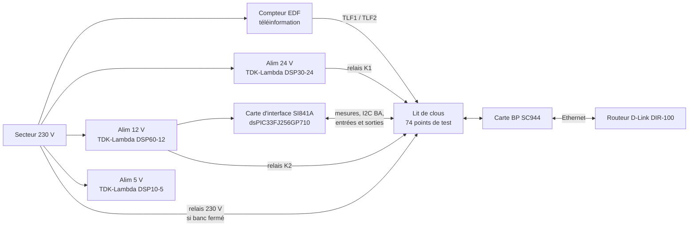

# 2. Architecture

## Alimentations

Source : folio 2 du schéma, `etude/croquis-alimentations-banc.pdf`, nomenclature ARF Test.

- Trois alimentations rail DIN TDK-Lambda : **DSP30-24** (24 V), **DSP60-12** (12 V) et **DSP10-5** (5 V).
- Le **24 V** joue le rôle de l'alimentation secteur de la carte, le **12 V** celui de l'alimentation secourue (batterie). Le croquis annote : « vert si on retrouve le 12 V appliqué sur ALIMPH / ALIMN ».
- Chaque tension arrive sur la carte testée par un relais Finder 32.21 (bobine 12 V) commandé par le dsPIC à travers un BC847C et une résistance de 4,7 kΩ, avec une diode BAT54C de roue libre (`etude/croquis-relais-alim-bp.pdf`). Signaux : `UC_P24V` et `UC_P12V`.
- La carte d'interface fabrique son **3,3 V** avec un convertisseur Traco **TSR 1-2433** à partir du 12 V.

## Sécurité 230 V

Source : `etude/croquis-relais-230v.pdf`, folio 15 (fil pilote).

Le 230 V qui sert au test du fil pilote passe par deux relais (un sur la phase, un sur le neutre). Leurs bobines sont en série avec le **détecteur d'ouverture du banc** : le contact est fermé seulement lorsque la presse est fermée. Banc ouvert, il n'y a donc pas de 230 V sur le lit de clous.

> Ce point est déduit d'un croquis manuscrit. À vérifier sur le banc réel avant toute mise sous tension.

## Remise à zéro par le palpeur

Le dsPIC reste en reset tant que le palpeur n'est pas enfoncé, c'est-à-dire tant que le banc n'est pas fermé avec une carte en place. Fermer la presse lance donc le test, l'ouvrir l'arrête. L'entrée « palpeur » du dsPIC (`UC_PALP`) ne lit pas le palpeur : elle lit l'image du strap de forçage du +15VSP (voir la séquence).

## Masses

`etude/scan-ajout-masses.pdf` annote le folio « Borniers » du schéma de la SC944-0C : la masse d'une entrée tout-ou-rien du BP est toujours à droite de la paire de bornes correspondante. Le croquis montre l'exemple du détecteur d'ouverture de porte (`DOP_G`, `DOP_D`).

## Liaisons avec la carte testée

| Fonction | Signaux | Ce que fait le banc | Folio |
|---|---|---|---|
| Alimentation | `ALIMPH`, `ALIMN` | Applique 24 V ou 12 V par relais | 2 |
| Mesure des tensions | 15V, 15VS, 5VS, 3V3S, 15VSP, 12VSP | Ponts diviseurs vers les entrées analogiques du dsPIC | 4, 5 |
| Téléinformation | `TLF1`, `TLF2` | Relie le compteur | 6 |
| Écran | `ECR1`, `ECR2` | Relie l'écran de façade | 7 |
| Alarme | détecteurs de présence 1 et 2, détecteur d'ouverture, sirènes intérieure et extérieure, détecteur d'ouverture du tableau | Mesure les alimentations, simule signal et fraude par boutons | 8, 9 |
| Détecteurs | fuite d'eau (`DFELL`, `DFELV`), pluie (`DPL`), vent (`DV`), bouton magique (`BM`) | Boutons ; le vent passe par un relais statique CPC1017N commandé par `UC_DV` | 10 à 13 |
| Arrosage | `ARALIMPH`, `ARALIMN`, `AREVG`, `AREVD` | Voyant | 14 |
| Fil pilote | `FPZJ`, `FPZN`, `FPSDB1`, `FPSDB2` | Voyants par alternance, interrupteurs à bascule, 230 V par relais | 15 |
| Machines à laver, prises de sécurité, cumulus | `MALG/D`, `PSG/D`, `CUMG/D` | Voyants | 16 |
| Bus BA | `BA_ALIM`, `BA_GND`, `BA_SCL`, `BA_SDA` | Mesure l'alimentation, répond en I2C | 17 |
| Ethernet | RJ45 | Câblage direct vers le switch, résultat lu sur l'IHM de la carte | 18 |
| Programmation | connecteur 2×5 « Programmation (optionnel) » | 10 perçages de réserve | plan des points de test |
