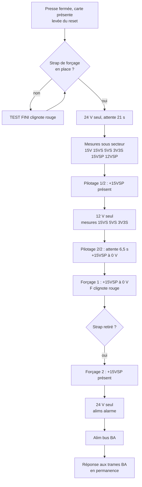

# 3. Séquence de test

Source : `logiciel/spec-soft-test-bp-v4.doc` (v4.0 du 24/02/2015, N. Gille), transcrite dans [`logiciel/spec-soft-test-bp-v4.md`](../logiciel/spec-soft-test-bp-v4.md).

Cette séquence est celle du logiciel du dsPIC de la carte d'interface. Le code source est publié dans `essensys-board-SC841A/SC841A/Prog/Banc_BP_V2_FAST/` ; ses notes de version le disent conforme à cette spécification v4. Les seuils ci-dessous viennent du code.

## Étapes

| # | Étape | Action du banc | Voyant |
|---|---|---|---|
| 1 | Reset | Le dsPIC est en reset tant que le palpeur n'est pas enfoncé. La carte testée n'est pas alimentée. | – |
| 2 | Lancement | Tant que le strap de forçage +15VSP est « enlevé » (entrée ouverte), le test n'avance pas. | TEST FINI clignote rouge |
| 3 | Démarrage | Strap « mis » : alimentation en **24 V seul**, attente de **21 s**. | TEST FINI éteint |
| 4 | Alims sous secteur | Mesure de 15V, 15VS, 5VS, 3V3S, +15VSP, +12VSP. | Un voyant par tension, ligne « Alim secteur » |
| 5 | Pilotage 1/2 | +15VSP doit être présent. | – |
| 6 | Alims sous secouru | Application du 12 V **puis** coupure du 24 V. Mesure de 15VS, 5VS, 3V3S. | Un voyant par tension, ligne « Alim secourue » |
| 7 | Pilotage 2/2 | Attente que le BP coupe le +15VSP (**6 500 ms**, valeur prise pour le firmware 092-31 en mode test). +15VSP doit être à 0 V flottant. | **P** vert si 5 et 7 bons, rouge sinon |
| 8 | Forçage 1 | +15VSP doit être à 0 V flottant. | **F** clignote rouge : l'opérateur doit retirer le strap |
| 9 | Forçage 2 | Attente sans limite du retrait du strap, puis +15VSP doit être présent. | **F** vert si 8 et 9 bons, rouge sinon |
| 10 | Alims alarme | Application du 24 V **puis** coupure du 12 V. Mesure des alimentations : détecteur de présence 1, détecteur de présence 2, sirène intérieure, sirène extérieure. | Un voyant par alimentation |
| 11 | Alim bus BA | Mesure de l'alimentation du bus BA. | Voyant « Boîtiers auxiliaires » |
| 12 | Communication BA | Le banc attend en permanence une trame BA « pièces de vie » (PDV) et y répond. Le BP lance le scénario « Personnalisé » ; il analyse lui-même le résultat et l'affiche sur son IHM. | – |
| 13 | Fin | Retirer la carte relâche le palpeur et remet le dsPIC en reset. Une nouvelle carte relance tout. | – |

Règle commune aux mesures : voyant **vert** si la mesure est bonne, **rouge** sinon.

## Ordre des commutations d'alimentation

La spec insiste sur l'ordre, pour ne jamais laisser la carte sans alimentation :

- passage en secouru : appliquer le 12 V **d'abord**, couper le 24 V **ensuite** ;
- retour en secteur : appliquer le 24 V **d'abord**, couper le 12 V **ensuite**.

## Le strap de forçage

Le strap de forçage du +15VSP est un bouton à deux voies : une voie fait le strap lui-même, l'autre renvoie son image au dsPIC sur l'entrée « palpeur ». L'opérateur le met au début et le retire quand **F** clignote.

## Seuils de mesure

Le convertisseur est sur 12 bits (0 à 4095) et chaque tension passe par un pont diviseur. Les seuils sont dans `Banc_BP.h` du dépôt `essensys-board-SC841A`. Une mesure est bonne si elle est **au-dessus** du seuil, sauf mention contraire.

| Mesure | Seuil | Mesure | Seuil |
|---|---|---|---|
| 15V | 3980 | 15VS en secouru | 2792 |
| 15VS | 3850 | 5VS en secouru | 3509 |
| 5VS | 3500 | 3V3S en secouru | 3752 |
| 3V3S | 3749 | +15VSP en secouru | **inférieur** à 25 |
| +15VSP | 3844 | +15VSP au forçage | 2786 |
| +12VSP | 3555 | Alim détecteur de présence 1 | 3719 |
| Alim bus BA | 3722 | Alim détecteur de présence 2 | 3721 |
| Alim sirène intérieure | 3722 | Alim sirène extérieure | 3719 |

Le tableau manuscrit `etude/mesures-analogiques-annexe-spec-v4.pdf` est le relevé qui a servi à fixer ces seuils (valeur réelle, valeur après le pont, valeur lue ; en noir la valeur nominale, en rouge le seuil).

## Écarts entre la spécification et le code

Relevés à la lecture de `Fonction_Test.c` :

- **Voyant P** : vert si le +15VSP était au-dessus de son seuil sous secteur **et** en dessous de 25 en secouru.
- **Voyant F** : pendant l'attente du retrait du strap, il alterne rouge et vert (la spec dit « clignote rouge »). Le premier contrôle du forçage ne refait pas de mesure : il réutilise la mesure du +15VSP en secouru.
- **Commutation** : les deux relais d'alimentation restent fermés ensemble 100 ms avant la coupure de l'ancienne tension.
- **Version du BP** : les notes de version annoncent un fonctionnement à partir du BP **091-30** ; la spec cite la 092-31.
- **Bus BA** : la réponse aux trames se fait par interruption I2C ; la boucle principale ne fait plus rien après les mesures.

## Signal des sirènes

`etude/calculs-test-signal-sirenes-v1.xlsx` calcule le pont diviseur du test de la commande de sirène sous 15 V :

| Résistance série | Résistance de charge | Tension | Courant |
|---|---|---|---|
| 4 700 Ω | 4 700 Ω | 7,5 V | 1,6 mA |
| 10 000 Ω | 4 700 Ω | 4,8 V | 1,0 mA |
