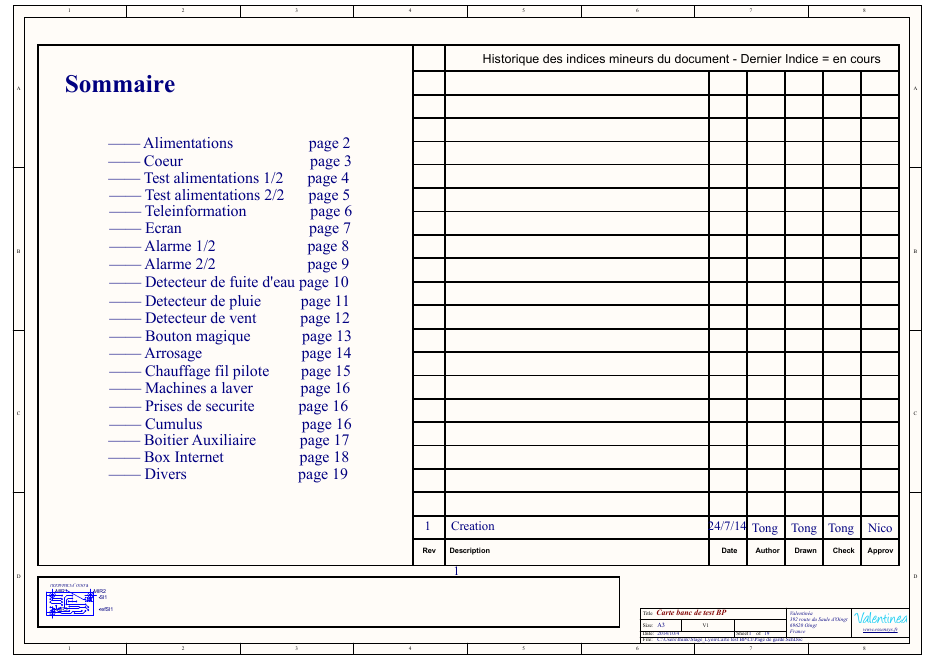
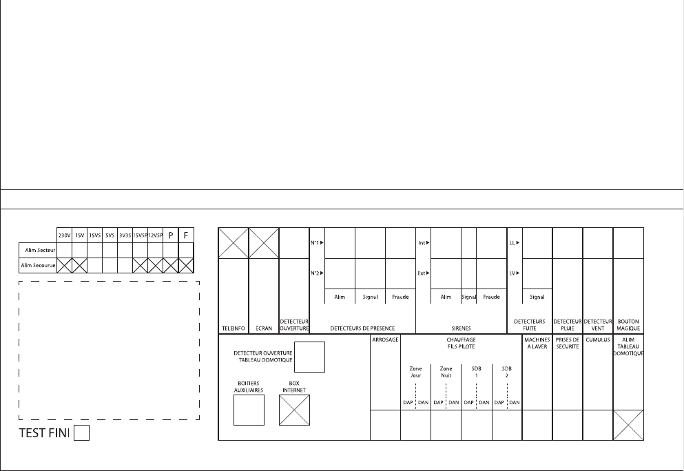

# 4. Carte d'interface SI841A

Source : `carte-interface-SI841A/schema/schema-banc-bp-v4.pdf` (Altium Designer, 19 folios, 04/10/2014).

La SI841A est la grande carte verte en façade du banc. La nomenclature ARF Test l'appelle « Carte Clavier » (référence SI841AA, fournie par Valentinéa). Le cartouche du schéma l'appelle « Carte banc de test BP » sur le sommaire et « Carte banc de test BA » sur les autres folios : c'est une coquille du cartouche, la carte teste bien le BP.

> La SI841A est la carte du dépôt public **`essensys-board-SC841A`**. Ce dépôt contient le projet Altium complet (`.SchDoc`, `.PcbDoc`), les Gerber de fabrication, l'implantation, la nomenclature et le logiciel. Le schéma PDF archivé ici (04/10/2014) est antérieur à celui du dépôt public (`Câblage/Schemas_SI841A.PDF`, 30/11/2014) : en cas d'écart, le dépôt public fait foi.

## Folios

| Folio | Titre | Contenu |
|---|---|---|
| 1 | Sommaire | Historique : indice 1, création le 24/07/2014 |
| 2 | Alimentations | Entrées 24 V et 12 V (borniers Phoenix 1711725), relais Finder 32.21 vers la carte testée (`UC_P24V`, `UC_P12V`), convertisseur TSR 1-2433 pour le 3,3 V |
| 3 | Cœur | dsPIC33FJ256GP710 (100 broches), connecteur de programmation |
| 4 | Test alimentations 1/2 | Ponts diviseurs de mesure : `UC_SECT15V`, `UC_SECT15VS`, `UC_SECT5VS`, `UC_SECT3V3S`, `UC_SECT15VSP`, `UC_SECT12VSP` |
| 5 | Test alimentations 2/2 | Voyants bicolores des alimentations (secteur, secouru, pilotage, forçage), commandés par des MOS ZXMN3A01F ; test de présence du 230 V (`PH_TEST_ALIM`, `N_TEST_ALIM`) |
| 6 | Téléinformation | Borniers `TLF1`, `TLF2` |
| 7 | Écran | Borniers `ECR1`, `ECR2`, fixations de l'écran |
| 8 | Alarme 1/2 | Détecteur d'ouverture de porte, détecteurs de présence 1 et 2 : alimentation mesurée, boutons « signal » et « fraude » |
| 9 | Alarme 2/2 | Sirènes intérieure et extérieure (alimentation mesurée, signal, fraude), détecteur d'ouverture du tableau domotique |
| 10 | Détecteur de fuite d'eau | Lave-linge et lave-vaisselle (`DFELL`, `DFELV`), boutons |
| 11 | Détecteur de pluie | Bouton |
| 12 | Détecteur de vent | Relais statique CPC1017N commandé par `UC_DV`, bouton |
| 13 | Bouton magique | Bouton |
| 14 | Arrosage | Voyant sur la sortie électrovanne |
| 15 | Chauffage fil pilote | Zone jour, zone nuit, salle de bain 1, salle de bain 2 : voyants L-964GD par alternance, interrupteurs à bascule, relais 230 V |
| 16 | Machines à laver, prises de sécurité, cumulus | Voyants |
| 17 | Boîtier auxiliaire | Bus I2C (`UC_SCL`, `UC_SDA`) avec protections, mesure de `BA_ALIM`, voyant I2C |
| 18 | Box Internet | « Rien à faire » : câblage direct sur le switch Ethernet, résultat sur l'IHM |
| 19 | Divers | Voyant TEST FINI, entrée palpeur (`PALPEUR_1`, `PALPEUR_2`), 19 trous de fixation |

## Signaux du microcontrôleur

Relevés dans le texte du schéma (préfixe `UC_`). `_V` et `_R` sont les deux couleurs d'un voyant bicolore.

| Groupe | Signaux |
|---|---|
| Commande des alimentations | `UC_P24V`, `UC_P12V` |
| Mesures sous secteur | `UC_SECT15V`, `UC_SECT15VS`, `UC_SECT5VS`, `UC_SECT3V3S`, `UC_SECT15VSP`, `UC_SECT12VSP` |
| Mesures d'alarme et de bus | `UC_DPR1ALIM`, `UC_DPR2ALIM`, `UC_SINTALIM`, `UC_SEXTALIM`, `UC_BA_ALIM` |
| Voyants secteur | `UC_SECT15V_V/R`, `UC_SECT15VS_V/R`, `UC_SECT5VS_V/R`, `UC_SECT3V3S_V/R`, `UC_SECT15VSP_V/R`, `UC_SECT12VSP_V/R` |
| Voyants secouru | `UC_SECOU15VS_V/R`, `UC_SECOU5VS_V/R`, `UC_SECOU3V3S_V/R` |
| Voyants pilotage et forçage | `UC_PILOTALIM_V/R` (P), `UC_FORCALIM_V/R` (F) |
| Voyants alarme | `UC_LEDDPR1ALIM_V/R`, `UC_LEDDPR2ALIM_V/R`, `UC_LEDSINTALIM_V/R`, `UC_LEDSEXTALIM_V/R` |
| Bus BA | `UC_SCL`, `UC_SDA`, voyant `UC_I2C_V/R` |
| Divers | `UC_PALP` (image du strap de forçage), `UC_DV` (vent), `UC_TEST_FINI_V/R` |

## Composants principaux

| Repère | Composant | Fiche |
|---|---|---|
| Microcontrôleur | Microchip dsPIC33FJ256GP710A (quartz HS avec PLL, d'après les bits de configuration du code) | – |
| Voyants bicolores | Kingbright L-937EGW (rouge et vert) | `datasheets/composants/` |
| Commande des voyants | Diodes Inc. ZXMN3A01F (MOS canal N) | `datasheets/composants/` |
| Roue libre des relais | Diodes Inc. BAT54C | `datasheets/composants/` |
| Relais | Finder 32.21, bobine 12 V | – |
| Convertisseur 3,3 V | Traco TSR 1-2433 | – |
| Boutons | Omron B3F-4005 | – |
| Interrupteurs fil pilote | NKK UB15SKW03N-C | – |
| Borniers | Phoenix 1711725 (MKDS, 2 voies) | – |
| Colonnettes | Catalogue Farnell | `datasheets/composants/` |

## Programmation du dsPIC

`etude/scan-connecteur-prog-dsp.pdf` donne le brochage du connecteur de programmation (Phoenix 1843635, 5 voies) :

| Broche | Signal |
|---|---|
| 1 | MCLR |
| 2 | +5 V |
| 3 | 0 V |
| 4 | CLK |
| 5 | DAT |

## Logiciel

Projet MPLAB X `Banc_BP_V2_FAST` dans `essensys-board-SC841A/SC841A/Prog/` : sources C, fichier `.hex` de production (24/02/2015) et notes de version. La protection en lecture du microcontrôleur est désactivée dans les bits de configuration.

| Fichier | Rôle |
|---|---|
| `main.c` | Bits de configuration, enchaînement : attente du strap, 21 s, tests |
| `Fonction_Test.c` | Séquence de test et allumage des voyants |
| `Fonction_Alim.c` | Mesures analogiques (moyenne de 8 échantillons) |
| `Fonction_I2C.c` | Réponse aux trames du bus BA |
| `Fonction_LED.c`, `Fonction_Init.c`, `Fonction_Clk.c` | Voyants, initialisation, horloge et temporisations |
| `Banc_BP.h` | Noms des voyants et seuils de mesure |

## Face avant

- `face-avant/ci-v5.pdf` et `ci-v5.ai` : dernier dessin (21/10/2014). `ci-v5.ai` est identique octet pour octet à `archives/ci-v4.ai`.
- `face-avant/ci-plan-mecanique-v1.pdf` : cotes mécaniques.
- `face-avant/archives/` : versions 1 à 4 en Illustrator, DXF et DWG. Les suffixes des DXF de la v4 sont les options d'export d'Illustrator.
- `serigraphie/` : sérigraphie de la zone BP et du tableau des alimentations, en version texte et en version vectorisée.

À gauche : le tableau des alimentations (230V, 15V, 15VS, 5VS, 3V3S, 15VSP, 12VSP, P, F ; lignes « Alim secteur » et « Alim secourue »), l'emplacement de l'écran et le voyant TEST FINI. À droite : une colonne par fonction de la carte.

## Fichiers de fabrication

`gerber-non-route-envoye-arf-test/` contient les Gerber et les perçages de la SI841A **avant routage** : les couches internes `IN1` et `IN2` sont vides. Ces fichiers ont servi à ARF Test pour la mécanique (contour, trous, sérigraphie). Les Gerber routés (17/11/2014) sont dans `essensys-board-SC841A/SC841A/GERBERS/`.
