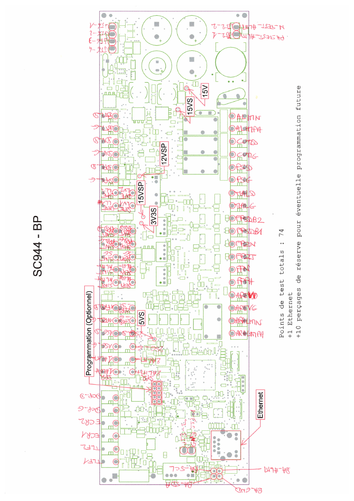

# 5. Points de test de la SC944

Sources : `points-de-test-SC944/si944c-pt-noms-v1.pdf` (noms manuscrits) et `si944c-pt-emplacement-v3.pdf` (positions).

Le plan annonce : **74 points de test**, **+ 1 Ethernet**, **+ 10 perçages de réserve** pour une éventuelle programmation future.

Le plan est dessiné vu de dessous (côté clous) : les noms manuscrits sont en miroir.

## Groupes

| Groupe | Points | Emplacement |
|---|---|---|
| Tensions internes | 15V, 15VS, 15VSP, 12VSP, 3V3S, 5VS | Au centre de la carte, entourés sur le plan |
| Alimentation | ALIMPH, ALIMN (plusieurs paires), test 230 V | Borniers du bord |
| Fil pilote | FPZJ, FPZN, FPSDB1, FPSDB2 | Bornier du bord |
| Arrosage, cumulus, machines, prises | AREVG/D, ARALIMPH/N, CUMG/D, MALG/D, PSG/D | Bornier du bord |
| Alarme | détecteurs de présence 1 et 2 (alim, signal, fraude), sirènes intérieure et extérieure, détecteur d'ouverture | Bornier opposé |
| Détecteurs | fuite, pluie, vent, bouton magique | Bornier opposé |
| Écran et téléinformation | ECR1, ECR2, TLF1, TLF2 | Coin côté Ethernet |
| Bus BA | BA-ALIM, BA-GND, BA-SCL, BA-SDA | Coin côté Ethernet |
| Programmation | connecteur 2×5, optionnel | Près du microcontrôleur |
| Ethernet | RJ45 | Câble direct, sans clou |

> Cette liste regroupe les noms lisibles sur le plan. Elle ne remplace pas le plan : pour le nom exact et la position d'un clou, se reporter au PDF.

## Versions

| Fichier | Date | Remarque |
|---|---|---|
| `archives/si944c-pt-emplacement-v1.pdf` | 03/07/2014 | Premier jet |
| `archives/si944c-pt-emplacement-v2.pdf` | 28/07/2014 | |
| `si944c-pt-emplacement-v3.pdf` | 04/10/2014 | Version de référence pour les positions |
| `si944c-pt-noms-v1.pdf` | fichier daté de 2018 | Seule version avec les noms |

Les plans portent la référence SI944**C**. Le banc est étiqueté « 944-BP » et le dépôt de la carte est `essensys-board-SC944D` : la compatibilité des positions avec l'indice D n'est pas établie par ces archives.
