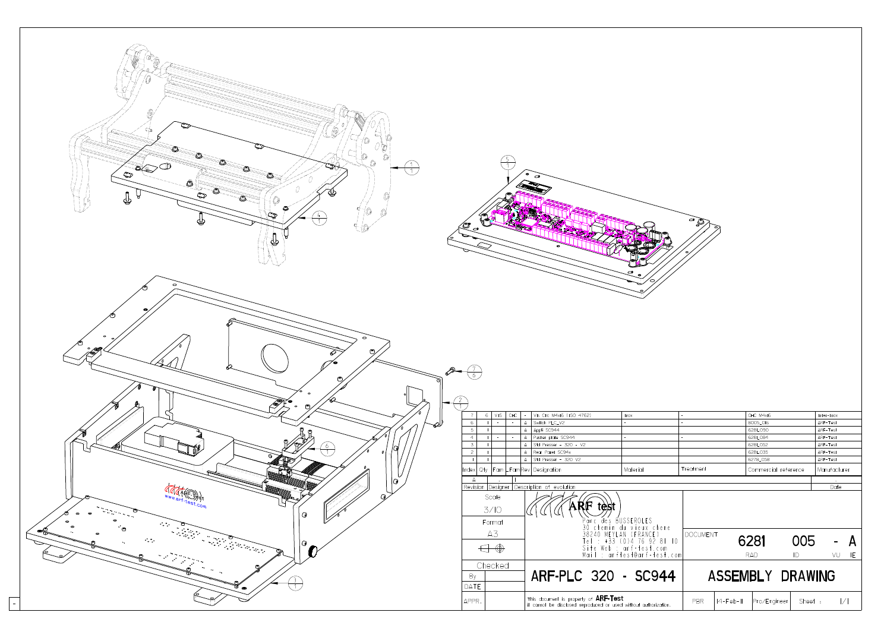

# 6. Mécanique : dossier ARF Test 6281

Source : `mecanique-arf-test-6281/` (dossier d'étude livré par ARF Test, 23/01/2015). Les noms de fichiers d'origine sont conservés, car `_Index.html` y renvoie.

> Ces plans sont marqués propriété d'ARF Test, avec interdiction de les diffuser ou de les reproduire sans autorisation. Ils ne doivent pas quitter ce dépôt privé.

## Contenu

| Dossier | Contenu |
|---|---|
| `ASM's Affaire/` | 14 plans propres à l'affaire 6281 |
| `ASM's Commun/` | 4 plans de sous-ensembles standards ARF Test |
| `BOM/` | Nomenclature complète (`Full`) et récapitulative (`Recap`), texte en ISO-8859-1 |
| `Include/` | Logo ARF Test |
| `_Index.html` | Index d'origine du dossier |
| `Image Interface.jpg`, `Photo interface.jpg` | Image de synthèse et photo du banc avant montage de la carte d'interface |

## Plans de l'affaire

| Plan | Désignation |
|---|---|
| 6281_005 | Ensemble ARF-PLC 320 - SC944 (plan d'assemblage) |
| 6281_035 | Panneau arrière SC94x |
| 6281_052 | Presse standard 320 V2 |
| 6281_062 | Coffret ARF-PLC-03 V2 |
| 6281_068 | Plaque de base SC944 |
| 6281_084 | Plaque de poussée SC944 |
| 6281_090 | Applicatif SC944 |
| 6281_091 | Dessous SC944 |
| 6281_092 | Dessus SC944 |
| 6281_102 | Presse PCB |
| 6281_104 | Presse basse PCB |
| 6281_111 | Panneau droit V2 |
| 6281_117 | Panneau gauche V2 |
| 6281_158 | Plaque de fond (320) SC944 |

Sous-ensembles communs : 6278_058 (presse standard 320 V2), 6278_125 (centrage), 8005_016 (interrupteur PLC V2), 8005_083 (vis moletée).

## Équipements dans la nomenclature

| Équipement | Référence | Fabricant |
|---|---|---|
| Alimentation rail DIN 24 V | DSP30-24 | TDK-Lambda |
| Alimentation rail DIN 12 V | DSP60-12 | TDK-Lambda |
| Alimentation rail DIN 5 V | DSP10-5 | TDK-Lambda |
| Routeur | DIR-100 | D-Link |
| Carte clavier | SI841AA | Valentinéa |
| Rail DIN | 6281_106 | – |

Les panneaux sont en stratifié compact (« Kompact ») de 10 mm.

## Implantation

`etude/croquis-implantation-mecanique.pdf` est le croquis d'origine : carte d'interface de 360 mm de large, rail DIN bas profil, emplacement de l'écran (IHM), trous de 4,8 mm, distance entre la carte et le dessus de la carte IHM.

## Câbles

`etude/cables-v1.docx` liste des cordons tout faits envisagés pour relier le lit de clous à la carte d'interface :

| Cordon | Référence Farnell | Type |
|---|---|---|
| Videk 1530 | 1525883 | Sub-D demi-pas 50 points vers Sub-D demi-pas 50 points |
| Videk 1557 | 1525919 | Idem en 68 points |
| Meilhaus AK-D78/1 | 9568352 | Sub-D 78 points mâle/femelle |

Sur les photos de 2026, la liaison visible est une nappe grise sur connecteur HE10 : le choix final n'est pas documenté.
